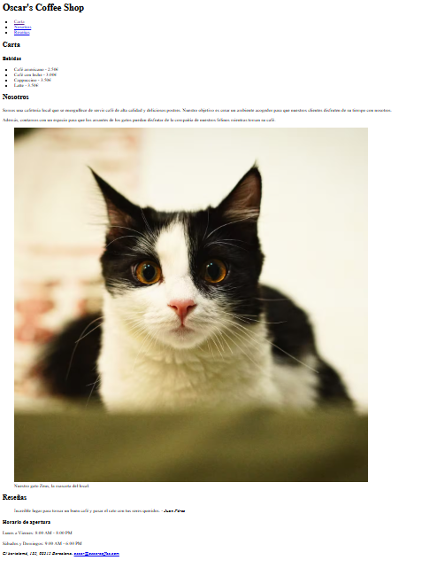

# Oscar's Coffee Shop

Página web de una cafetería ficticia, hecha como ejercicio para practicar HTML semántico.

Elegí este proyecto porque una página de cafetería reúne casi todas las etiquetas básicas que necesito aprender.

## Qué practica este proyecto

- Estructura de documento: `header`, `nav`, `main`, `section`, `aside`, `footer`
- Jerarquía de títulos y enlaces internos con `id`
- Citas (`blockquote` y `cite`), imágenes con `figure` y `figcaption`, y `address`

## Cómo verlo

Descarga el repositorio y abre `index.html` en tu navegador.

## Estado

Solo HTML, sin estilos. Próximo paso: añadir CSS (modelo de caja, Flexbox y Grid).

---

Hecho por Òscar García mientras aprendo desarrollo web.