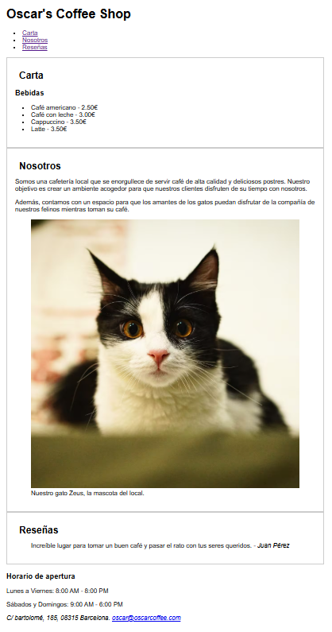

# Oscar's Coffee Shop

Página web de una cafetería ficticia, hecha como ejercicio para practicar HTML semántico y primeros pasos con CSS.

Elegí este proyecto porque una página de cafetería reúne casi todas las etiquetas básicas que necesito aprender.

## Qué practica este proyecto

- Estructura de documento: `header`, `nav`, `main`, `section`, `aside`, `footer`
- Jerarquía de títulos y enlaces internos con `id`
- Citas (`blockquote` y `cite`), imágenes con `figure` y `figcaption`, y `address`
- Modelo de caja (`margin`, `padding`, `border`, `box-sizing`) y centrado de contenido con `max-width` y `margin: 0 auto`

## Cómo verlo

Descarga el repositorio y abre `index.html` en tu navegador.

## Estado

HTML semántico y primeros estilos con CSS (modelo de caja). Próximo paso: Flexbox para el menú de navegación.

---

Hecho por Òscar García mientras aprendo desarrollo web.